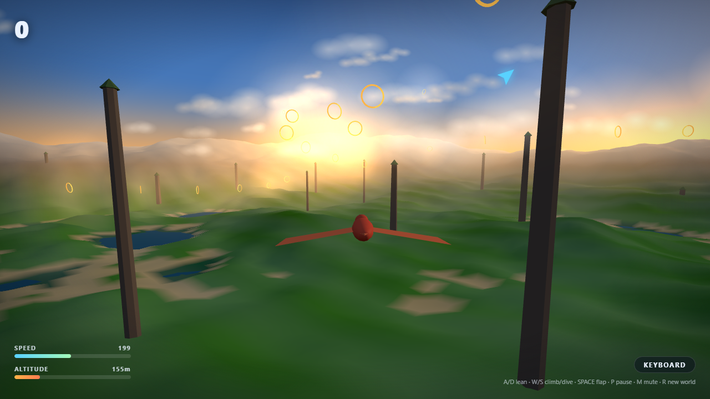

# 🪽 ZEPHYR

**A 3D open-world flying game where your body is the controller.**

Stand in front of your webcam, spread your wings, and fly. Lean to bank, raise your arms
to climb, drop them to dive, pump your arms to flap — or just use the keyboard.
Soar a procedurally generated skyworld of islands, ring chains, rock-pillar slaloms,
and drifting clouds through golden-hour light.



## Quick start

```bash
npm install
npm run dev        # → http://localhost:5173
```

First build already done? `dist/` ships too:

```bash
npm run preview    # serves the production build on :4173
```

> **Camera permission:** click **🎥 Fly with Motion** and allow the webcam.
> No camera (or denied)? **⌨️ Fly with Keyboard** always works — the game never requires a camera.

## Controls

| Motion (webcam) | Keyboard | Action |
|---|---|---|
| Lean torso left / right | `A` / `D` | Bank & turn |
| Raise both arms ↑ | `W` | Climb |
| Lower both arms ↓ | `S` | Dive & gain speed |
| Pump arms quickly | `Space` | Wing-flap boost |
| — | `P` / `Esc` | Pause |
| — | `M` | Mute |
| — | `R` | Generate a new world |

## Gameplay

- 🟡 Fly through **golden rings**: +100 each
- 🎯 Thread the **perfect center**: ×1.5
- 🔗 Chain rings within 6s: combo multiplier up to **×4**
- 🪨 Mind the **rock pillars** — they hurt
- ⛰️ Terrain skims free when you're climbing out; nose-in costs speed
- 🔁 Every world is a seed — press `R` for a brand-new universe

## Tech

- **Three.js** — WebGL renderer, procedural sky shader, vertex-colored terrain
- **MediaPipe Pose Landmarker** (vendored locally, CPU delegate) — 33-point body tracking at 60fps
- **Custom motion mapper** — EMA-smoothed roll/pitch from shoulder geometry, wrist-velocity flap detector (`src/core/motion-mapper.js`)
- **Energy-conserving glider physics** — altitude ⇄ airspeed trade, trim relaxation, clamped integration (`src/core/physics.js`)
- **Procedural WebAudio** — wind noise tied to speed, pentatonic combo chimes, whooshes; zero audio assets
- **Seeded PRNG (mulberry32)** — deterministic worlds, fully unit-testable generation

## Testing

```bash
npm test           # 39 unit tests: RNG, world-gen, physics, motion mapping, collisions, scoring, FSM
npm run smoke      # headless Playwright run: boots the game, flies it, screenshots it
```

The core game logic lives in pure modules (`src/core/`) with zero DOM/three imports —
every behavior was written test-first. The smoke test drives the real built game in
headless Chromium/Edge and verifies flight, pause, world regeneration, and console cleanliness.

## Project layout

```
src/
  core/          # pure, TDD'd logic: rng, world-gen, physics, motion-mapper, collisions, scoring, game-state
  render/        # three.js adapters: scene-builder, terrain, bird, rings, clouds, hud
  input/         # pose-tracker (MediaPipe), keyboard-fallback
  audio/         # sound-engine (procedural WebAudio)
  main.js        # orchestrator + game loop
public/mediapipe/  # vendored wasm runtime + pose model (no runtime CDN calls)
tests/           # vitest suites + playwright smoke test
```

## Performance notes

Built for integrated graphics (no GPU required): low-poly geometry, sprite-based
clouds/halos with distance fading, pixelRatio cap 1.5, fog culling, sub-stepped physics.

---

*Built by Hermes Agent · August 2026*
