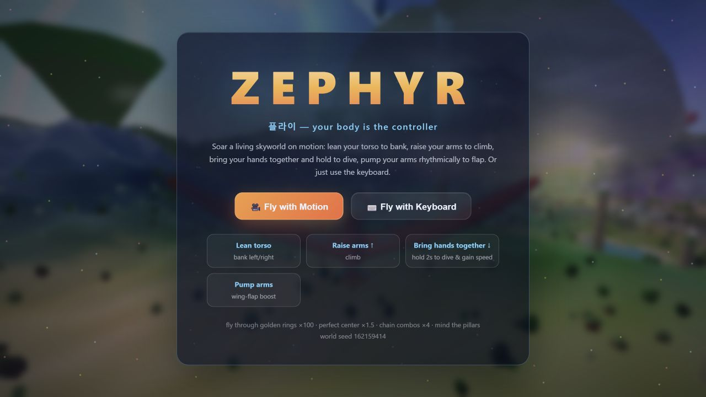

<!-- JUWON-PORTFOLIO-INTRO:START -->
# ZEPHYR / SKYBOUND



*Recorded browser 3D flight-game start screen; webcam and motion controls not verified.*

*브라우저의 실제 3D 비행 게임 시작 화면 · 카메라·동작 조종 미검증*

## English

A browser-based 3D flying-game prototype with webcam-pose and keyboard input paths. The portfolio's recorded start screen does not verify motion tracking on every device.

[View JUWON's portfolio](https://jupt.pages.dev/) · [Browse the project collection](https://jupt.pages.dev/projects)

**Scope:** This README presents the repository's documented intent and recorded visual evidence. It does not certify that every feature is complete, deployed, or currently working. Follow the original setup, safety, and license documentation below.

## 한국어

몸 움직임을 입력으로 사용하는 브라우저 3D 비행 게임.

[JUWON 포트폴리오 보기](https://jupt.pages.dev/) · [전체 프로젝트 보기](https://jupt.pages.dev/projects)

**확인 범위:** 저장소의 문서상 목적과 기록된 화면 근거를 소개합니다. 모든 기능의 완성·배포·현재 정상 작동을 보증하지 않습니다. 설치법·안전 주의사항·라이선스는 아래 기존 문서를 확인하세요.
<!-- JUWON-PORTFOLIO-INTRO:END -->

---

## Original documentation / 기존 문서

# 🪽 ZEPHYR

**A 3D open-world flying game where your body is the controller.**

Stand in front of your webcam, spread your wings, and fly. Lean to bank, raise your arms
to climb, drop them to dive, pump your arms to flap — or just use the keyboard.
Soar a lush Palworld-style skyworld — vivid meadows, 1600 instanced trees, wildflower
fields, turquoise lagoons, floating islands, ring chains and circling bird flocks —
while a live **pose-vision panel** shows exactly how your body maps to flight:
skeleton overlay, lean horizon, BANK/CLIMB/FLAP gauges, tracking FPS.


## Quick start

```bash
npm install
npm run dev        # → http://localhost:5173
```

First build already done? `dist/` ships too:

```bash
npm run preview    # serves the production build on :4173
```

> **Camera permission:** click **🎥 Fly with Motion** and allow the webcam.
> No camera (or denied)? **⌨️ Fly with Keyboard** always works — the game never requires a camera.

## Controls

| Motion (webcam) | Keyboard | Action |
|---|---|---|
| Lean torso left / right | `A` / `D` | Bank & turn |
| Raise both arms ↑ | `W` | Climb |
| Lower both arms ↓ | `S` | Dive & gain speed |
| Pump arms quickly | `Space` | Wing-flap boost |
| — | `P` / `Esc` | Pause |
| — | `M` | Mute |
| — | `R` | Generate a new world |

The **vision panel** (top-right during motion flight) renders the mirrored feed with a
gradient pose skeleton, highlighted shoulder/wrist joints, a rotating lean-horizon,
three live control meters, and tracker FPS — so you always see how your body drives the bird.

## Gameplay

- 🟡 Fly through **golden rings**: +100 each
- 🎯 Thread the **perfect center**: ×1.5
- 🔗 Chain rings within 6s: combo multiplier up to **×4**
- 🪨 Mind the **rock pillars** — they hurt
- ⛰️ Terrain skims free when you're climbing out; nose-in costs speed
- 🔁 Every world is a seed — press `R` for a brand-new universe

## Tech

- **Three.js** — WebGL renderer, procedural sky shader, vertex-colored terrain
- **MediaPipe Pose Landmarker** (vendored locally, CPU delegate) — 33-point body tracking at 60fps
- **Custom motion mapper** — EMA-smoothed roll/pitch from shoulder geometry, wrist-velocity flap detector (`src/core/motion-mapper.js`)
- **Energy-conserving glider physics** — altitude ⇄ airspeed trade, trim relaxation, clamped integration (`src/core/physics.js`)
- **Procedural WebAudio** — wind noise tied to speed, pentatonic combo chimes, whooshes; zero audio assets
- **Seeded PRNG (mulberry32)** — deterministic worlds, fully unit-testable generation

## Testing

```bash
npm test           # 39 unit tests: RNG, world-gen, physics, motion mapping, collisions, scoring, FSM
npm run smoke      # headless Playwright run: boots the game, flies it, screenshots it
```

The core game logic lives in pure modules (`src/core/`) with zero DOM/three imports —
every behavior was written test-first. The smoke test drives the real built game in
headless Chromium/Edge and verifies flight, pause, world regeneration, and console cleanliness.

## Project layout

```
src/
  core/          # pure, TDD'd logic: rng, world-gen, physics, motion-mapper, collisions, scoring, game-state
  render/        # three.js adapters: scene-builder, terrain, bird, rings, clouds, hud
  input/         # pose-tracker (MediaPipe), keyboard-fallback
  audio/         # sound-engine (procedural WebAudio)
  main.js        # orchestrator + game loop
public/mediapipe/  # vendored wasm runtime + pose model (no runtime CDN calls)
tests/           # vitest suites + playwright smoke test
```

## Performance notes

Built for integrated graphics (no GPU required): low-poly geometry, sprite-based
clouds/halos with distance fading, pixelRatio cap 1.5, fog culling, sub-stepped physics.

---

*Built by Hermes Agent · August 2026*
